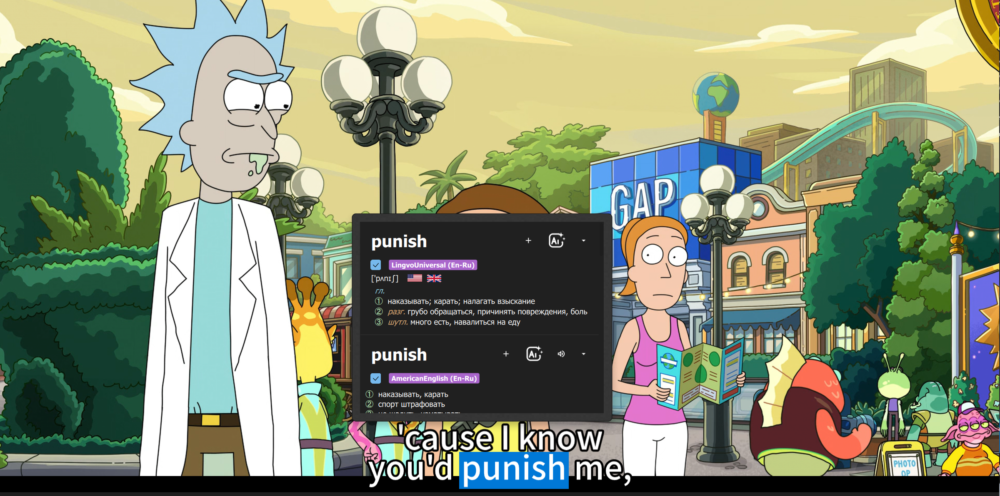
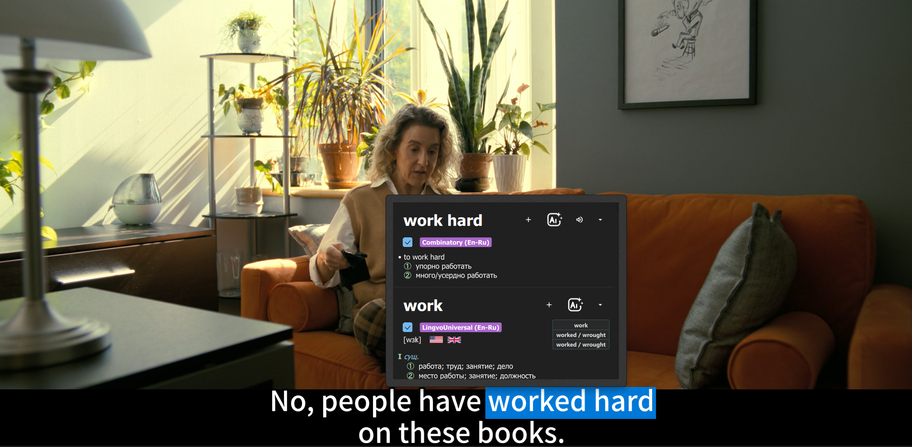

# Memento En-Ru

**Memento En-Ru** — программа для изучения английского по видео с субтитрами. Она помогает искать слова в словарях, слушать произношение и сохранять полезный материал в Anki.

Это неофициальный форк [Memento](https://github.com/ripose-jp/Memento) 2.0.2, адаптированный для английского языка и англо-русских словарей. Оригинальный Memento, созданный Ripose, в первую очередь ориентирован на изучение японского; в Memento En-Ru добавлены английский поиск, русский интерфейс и возможности для работы с английскими субтитрами.

## Интерфейс

## Возможности

### Читайте субтитры со словарём

Откройте видео с английскими субтитрами и наведите курсор на незнакомое слово, чтобы посмотреть его значение. Memento ищет слово и подходящие словоформы в подключённых словарях.

В зависимости от словаря статья может содержать перевод, транскрипцию, части речи, синонимы и другие сведения. Для неправильных глаголов программа также может показать основные формы.

Если незнакомое слово встретилось внутри самой статьи, его можно найти, не возвращаясь к субтитрам. Способ поиска и клавиша-модификатор настраиваются (по умолчанию — Shift).

### Сравнивайте словари

Подключайте собственные словари в формате Yomitan, меняйте их порядок, включайте и отключайте по необходимости.

### Создавайте карточки Anki

Добавляйте информацию из словарной статьи в Anki кнопкой «+». В зависимости от настроек можно передать статью целиком или только конкретную часть.

В карточку также можно автоматически добавлять аудиофрагмент из видео. В настройках задаётся запас времени до и после субтитра. Состав карточки зависит от настроек полей Memento и выбранного типа заметки Anki.

### Разбирайте предложения с AI

Если значение слов понятно, но всё предложение вызывает вопросы, откройте словарную статью и нажмите кнопку **AI**. Memento подготовит запрос по предложению, скопирует его в буфер обмена и откроет выбранный сайт. Вставьте текст в чат и отправьте его самостоятельно. Программа старается собрать предложение целиком, включая соседние фрагменты субтитров; если их не удаётся определить, используется доступный фрагмент.

В настройках поиска можно выбрать Gemini, ChatGPT, Claude или Алису и изменить текст запроса.

## Скачать и установить

Доступна бета-версия для **Windows x64**:

1. Откройте [страницу релиза](https://github.com/JuliaKClO/Memento-En-Ru/releases/tag/v2.0.2-enru.1-beta).
2. Скачайте `Memento-En-Ru-Windows-x64-Portable.zip`.
3. Распакуйте архив целиком в отдельную папку.
4. Запустите `memento.exe`. Установка через инсталлятор не требуется.

Не переносите `memento.exe` отдельно от папок и библиотек, которые лежат рядом с ним.

## Подключить словари

Словари в комплект программы не входят.

1. Откройте настройки Memento En-Ru и перейдите в раздел словарей.
2. Нажмите кнопку добавления.
3. Выберите архив словаря в формате Yomitan (`.zip`).

Добавленные словари можно включать, отключать и менять их порядок в настройках.

## Подключить Anki

1. Установите [Anki](https://apps.ankiweb.net/) и дополнение [AnkiConnect](https://ankiweb.net/shared/info/2055492159).
2. Запустите Anki.
3. В настройках интеграции Memento включите Anki, выберите колоду и тип заметки и настройте поля карточки.

## Ограничения

- Это бета-версия: возможны ошибки и особенности работы на разных компьютерах.
- Словари, Anki, AnkiConnect и звуковой пакет для Universal словаря устанавливаются или добавляются пользователем отдельно.
- Кнопка AI открывает сторонний сервис; доступность сервиса и учётной записи зависит от него.
- Базовая сборка предназначена для английского поиска; MeCab и IPADIC в неё не включены.

## Документация и лицензия

- [Подробная инструкция и сборка](README-EN-RU.md)
- [Список изменений](CHANGELOG-EN-RU.md)
- [Оригинальная документация Memento](README-UPSTREAM.md)
- [Исходный проект Memento](https://github.com/ripose-jp/Memento)
- [Лицензия GPL version 2](LICENSE)
- [Уведомления о сторонних компонентах](THIRD-PARTY-NOTICES.md) и [реестр библиотек](THIRD-PARTY-LIBRARIES.csv)
